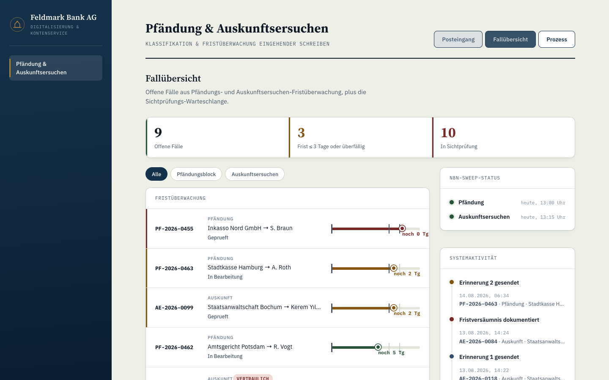
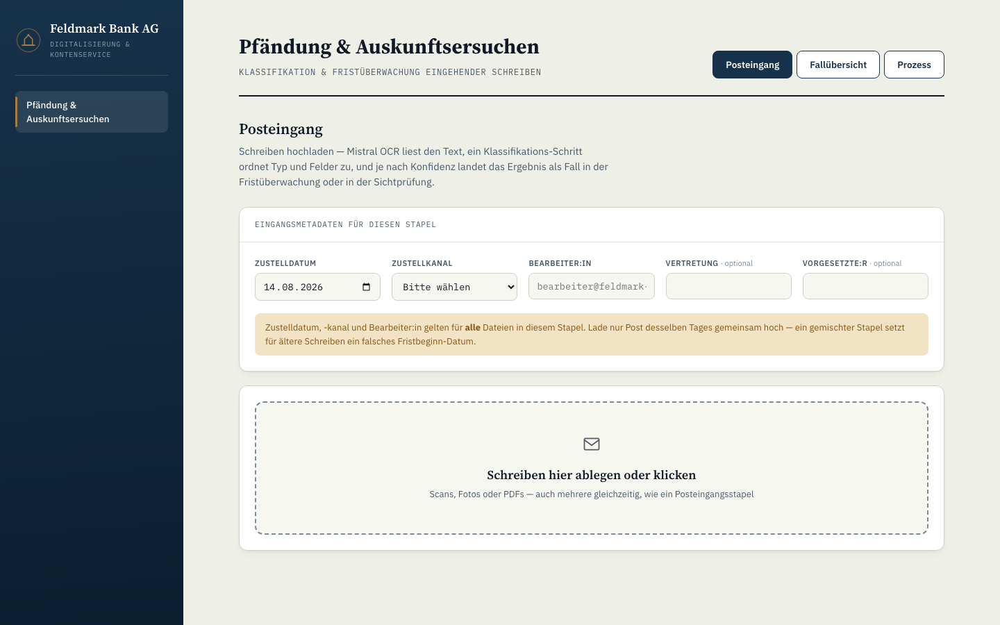
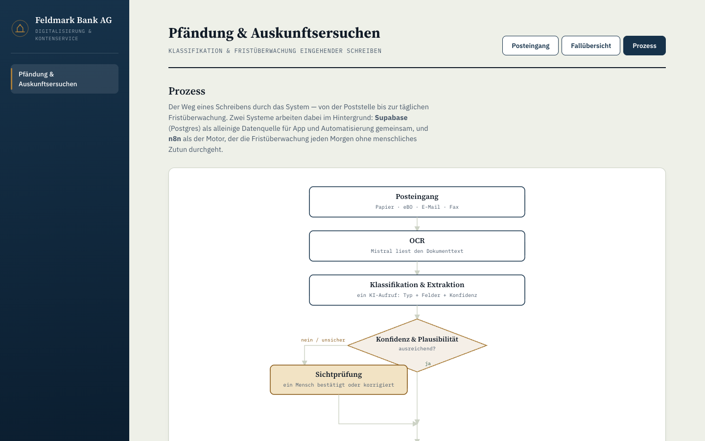
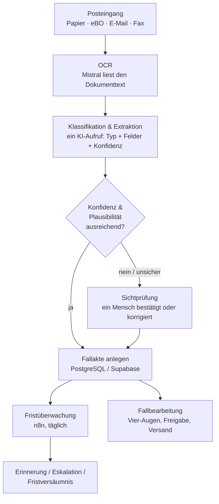

# Feldmark Bank AG — Digitale Fallbearbeitung für Pfändung & Auskunftsersuchen


-336791)


Ein Ende-zu-Ende-System, das zeigt, wie eine Bank den Posteingang für **Kontopfändungen** und **behördliche Auskunftsersuchen** von einem papierbasierten, personenabhängigen Prozess in einen digitalen, prüfbaren Workflow überführt — von der OCR-Erkennung eines eingehenden Schreibens bis zur automatisierten Fristüberwachung mit Eskalationslogik.

Entstanden als Abschlussprojekt im Digitalisierungsmanager-Bootcamp, angewendet auf einen realen Prozess aus eigener Fintech-Praxis.

**Projektstatus:** in Bearbeitung — die Bootcamp-Einreichung (Präsentation, Tests, Live-Demo) steht noch aus. Fachlich sind beide Prozesse (Pfändung und Auskunftsersuchen) inklusive aller Soll-Verzweigungen, Vier-Augen-Gates, Ablehnen-Pfad und automatisierter Fristüberwachung bereits umgesetzt; der konsolidierte, ehrlich gekennzeichnete Teststand (live verifiziert vs. nur code-abgeleitet vs. noch offen) steht in `docs/testmatrix.md`. Offen sind außerdem noch der reale Versandkanal und ein optionaler Self-Service-Statuslink (Details unter [Bewusste Grenzen](#bewusste-grenzen)).

<p align="center">
  
</p>

## Worum es geht

Eine fiktive Bank ("Feldmark Bank AG") bekommt täglich Pfändungs- und Überweisungsbeschlüsse sowie gerichtliche Auskunftsersuchen — auf Papier, per Fax, per E-Mail. Jedes Schreiben hat eine harte gesetzliche Frist (§ 840 ZPO, § 161 StPO). Im Ist-Prozess hängt die Fristsicherheit an einer einzelnen Person, die weiß, was in welchem Ordner liegt — mit allen Konsequenzen, die das bei Krankheit, Urlaub oder Fluktuation hat.

Das System übernimmt die drei Schritte, die sich tatsächlich automatisieren lassen, und lässt bewusst dort einen Menschen entscheiden, wo Ermessen gefragt ist:

1. **Erkennen** — ein hochgeladenes Schreiben wird per OCR gelesen und durch ein Sprachmodell klassifiziert und in strukturierte Felder extrahiert (Aktenzeichen, Gläubiger, Schuldner, Forderungshöhe, Fristtage …).
2. **Routen** — reicht die Konfidenz und ist der Fall plausibel, wird automatisch eine Fallakte angelegt; sonst geht das Schreiben in eine Sichtprüfungs-Warteschlange. Kein Fall verschwindet unbemerkt in einem Postkorb.
3. **Überwachen** — ein täglich laufender Workflow prüft jede offene Fallakte gegen ihre Frist, verschickt Erinnerungen, eskaliert bei drohendem Fristablauf an Vertretung/Vorgesetzte und dokumentiert Fristversäumnisse — inklusive Vier-Augen-Prinzip bei kritischen Entscheidungen.

## Screenshots

<table>
<tr>
<td width="50%"></td>
<td width="50%"></td>
</tr>
<tr>
<td align="center"><sub>Posteingang — Upload mit Eingangsmetadaten</sub></td>
<td align="center"><sub>Prozessdiagramm — der Weg eines Schreibens durchs System</sub></td>
</tr>
</table>

## Kernfunktionen

**Erfassung & Klassifikation**
- OCR + KI-Extraktion in einem Aufruf (Mistral `mistral-ocr-latest` + `mistral-small-latest`, JSON-Mode)
- Dokumenttyp-Klassifikation nach Pfändung, Pfändungserinnerung, Auskunftsersuchen und Auskunftsersuchenerinnerung (Einziehungs-/Überweisungsverfügung laufen als Varianten der Pfändung); alles andere landet sichtbar gekennzeichnet in der Sichtprüfung statt unbemerkt zu verschwinden
- Fail-closed-Routing: fehlende Konfidenzwerte gelten als *keine* Konfidenz, nie als automatisches Grünlicht
- Duplikat- und Erinnerungsschreiben-Erkennung gegen bestehende Aktenzeichen (whitespace-normalisiert)

**Fristüberwachung (n8n, täglich)**
- Zwei parallele Sweep-Workflows (Pfändung, Auskunftsersuchen) mit Idempotenz-Sperre — kein doppelter Versand bei mehrfachem Lauf
- Automatische Erinnerungsstufen, Eskalation an Vorgesetzte, Fristversäumnis-Dokumentation
- Eigener Fehler-Alert-Workflow, falls ein Sweep komplett ausfällt

**Fallbearbeitung mit Vier-Augen-Prinzip**
- **Pfändung:** P-Konto-Prüfung, automatische Pfändbarkeitsberechnung, deterministisch erzeugte Drittschuldnererklärung (§ 840 ZPO) — Freigabe und Versand als getrennte, protokollierte Schritte
- **Auskunftsersuchen:** Compliance wird bei Fallanlage sofort informiert, Rechtsgrundlagenprüfung legt fest, welche angefragten Punkte beantwortet werden, eine Kontosperre wird **nicht automatisch** ausgelöst — nur wenn das Schreiben selbst eine Beschlagnahme/einen Arrest trägt
- Weiche Vier-Augen-Prüfung serverseitig erzwungen (nicht nur im Frontend umgehbar), Übersteuerung wird als eigenes Ereignis protokolliert
- **Datendiskrepanz-Workflow:** fehlt nur der Schuldnername, blockiert das nicht mehr die Frist — der Fall läuft mit Platzhalter weiter, während parallel beim Gläubiger nachgefasst wird
- **Ablehnen-Pfad:** Drittschuldnererklärung und Auskunftsersuchen-Antwort können vor dem Versand explizit abgelehnt werden — protokolliert als eigenes Ereignis, gesperrt sobald der Fall bereits versendet wurde

**Prozess-Transparenz**
- Fall-Verlauf pro Akte und ein fallübergreifender Aktivitäts-Feed aus denselben Audit-Tabellen, die der Sweep ohnehin schreibt
- Live-Status beider n8n-Sweeps direkt im Dashboard
- Interaktives Prozessdiagramm des gesamten Ablaufs

## Architektur



Zwei Systeme arbeiten dabei zusammen: **PostgreSQL (Supabase)** als alleinige Datenquelle für App und Automatisierung, und **n8n** als Motor für alles, was zeitgesteuert ohne menschliches Zutun laufen muss. Die App selbst schreibt Fallakten; n8n liest sie täglich, aktualisiert Status und Protokoll — kein zweiter Schreibpfad, keine Datendrift zwischen beiden Systemen.

| Bereich | Technologie |
|---|---|
| Frontend | React 18, React Router, Vite |
| Backend | Node.js, Express, Multer (Upload) |
| Datenbank | PostgreSQL via Supabase (eigenes Schema `feldmark`) |
| OCR & Klassifikation | Mistral AI (`mistral-ocr-latest`, `mistral-small-latest`, JSON-Mode) |
| Automatisierung | n8n (Cron-Trigger, Postgres-Nodes, Fehler-Workflow) |
| Bildkonvertierung | Sharp, heic-convert (HEIC/HEIF-Uploads von Handyscans) |

## Projektstruktur

```
feldmark_app/                       Express + React (Vite)
  server/
    mistral.js                        OCR + Klassifikation + Routing-Logik
    db.js                             Postgres-Zugriff, Fallanlage, Protokoll
    index.js                          REST-API
    pkonto_drittschuldner.js          Deterministischer Erklärungstext-Generator
    auskunftsersuchen_antwort.js      Deterministischer Antwort-Generator
    datendiskrepanz.js                Textbausteine für den Rückfrage-Workflow
  src/
    App.jsx                           Router-Shell mit Sidebar-Navigation
    features/pfaendung-auskunftsersuchen/   Posteingang, Fallübersicht, Prozessdiagramm

*.sql                                Additive Schema-Dateien je Baustein
muster_dateien/                      Testdokumente (inkl. bewusster Plausibilitäts-Fallen)
docs/
  testmatrix.md                       Konsolidierte, lebende Testmatrix
  code_review/                        Datierte Code-Review-Berichte mit priorisierten Befunden
```

## Lokal starten

```bash
cd feldmark_app
npm install
cp .env.example .env   # DATABASE_URL (Postgres) + MISTRAL_API_KEY eintragen
npm run dev             # Backend (Port 4300) + Frontend (Port 5291) parallel
```

Die SQL-Dateien im Repo-Root sind additiv und einzeln lauffähig — sie legen Schema, Tabellen und ein paar Testfälle an (`feldmark_pfaendung_schema.sql`, `feldmark_auskunftsersuchen_schema.sql`, `feldmark_sichtpruefung_schema.sql`, sowie die `*_erweiterung_schema.sql`-Dateien für die Bearbeitungs-Bausteine).

## Bewusste Grenzen

Transparenz statt Understatement — das hier ist explizit **nicht** gebaut, mit Begründung:

- **Kein echter Versandkanal.** Beide n8n-Workflows bereiten Empfänger, Betreff und Text vollständig auf, senden aber nicht wirklich — es fehlt der letzte Node.
- **Keine Kernbank-Anbindung.** Kontostände und Guthaben werden manuell erfasst (Annahme A7 im Sollkonzept). In einer echten Umsetzung kämen diese Werte per API.
- **Kein Auth-/Rollensystem.** Das Vier-Augen-Prinzip ist serverseitig durchgesetzt, aber namensbasiert statt durch echte Logins — bewusst dokumentiert, nicht versteckt.
- **Konfidenzschwellen sind Startwerte**, kalibriert an vier realen Testdokumenten, nicht an Produktionsvolumen.

## Über dieses Projekt

Abschlussprojekt im Digitalisierungsmanager-Bootcamp, zugleich Portfolio-Stück — ein lauffähiges System für einen realen Prozess aus eigener Fintech-Praxis, kein Demo-Gerüst. Gebaut, getestet und iteriert von **Shota Tsertsvadze**.
