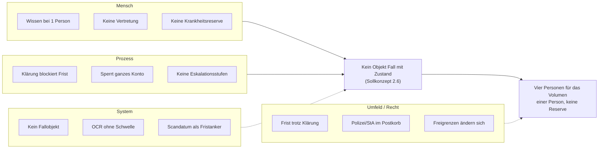

# Ishikawa — warum der Ist-Prozess strukturell keine Reserve hat

RALPH-PROGRESS.md Backlog #5. Portiert aus `Pfaendungsprozess_Methodenanwendung.html`
Abschnitt 3, hier als Markdown neben dem Code statt als separates HTML.
Inhalt nicht neu erarbeitet — nur der Ort geändert.

**Leitsymptom:** „Der Prozess braucht heute real rund vier Personen für ein
Volumen, das eine Person früher trug — und selbst die rechnerisch nötigen
2,8 VZÄ (Sollkonzept Abschnitt 1) haben keine Reserve für Krankheit oder
Urlaub."

Alle acht Teilursachen stammen direkt aus der Schwachstellenanalyse
(`docs/IST-PROZESS.md` bzw. Sollkonzept Abschnitt 2) und der
P-Konto-Ergänzung — hier nur nach den vier klassischen Ishikawa-Kategorien
sortiert, keine neu erfundenen Ursachen.

## Die vier Äste sind nicht gleichrangig

**Mensch** und **Prozess** laufen beide auf denselben Punkt zu, den das
Sollkonzept selbst als gemeinsame Wurzel benennt: *„Es gibt heute kein
Objekt „Fall" mit einem Zustand."* Ohne dieses Objekt kann Wissen nicht
geteilt werden (Mensch-Ast), kann keine Klärung parallel zur Frist laufen,
weil niemand den Fristzustand außerhalb einer Person kennt (Prozess-Ast),
und die System-Ursachen sind technische Symptome derselben Lücke.

Nur der **Umfeld/Recht-Ast ist strukturell unabhängig** — diese Ursachen
(Fristen laufen unabhängig vom Klärungsstand, Polizei/StA-Vertraulichkeit,
sich ändernde Freibeträge) bleiben bestehen, selbst wenn das Fallobjekt
gebaut ist. Kein Diagramm mit vier konvergierenden Ästen ist Zufall — es
deutet auf eine einzelne strukturelle Wurzelursache statt vier unabhängige
Probleme hin. Der 5-Why in `docs/5WHY-DRITTSCHULDNER-KLAERUNG.md` folgt
genau diesem Punkt.

## Cross-Referenz: was das gebaute System gegen jeden Ast tut

| Ast | Teilursache | Status im gebauten System |
|---|---|---|
| Mensch | Wissen bei 1 Person | ✅ Fallobjekt mit `bearbeiter_email`/`vertretung_email`/`vorgesetzte_email` als feste Felder je Fall (`feldmark_pfaendung_schema.sql`), nicht Wissen im Kopf |
| Mensch | Keine Vertretung | ✅ n8n-Sweep adressiert Erinnerung 2 automatisch an die Vertretung |
| Mensch | Keine Krankheitsreserve | ✅ Eskalation an Teamleitung unabhängig davon, ob die ursprünglich zuständige Person erreichbar ist |
| Prozess | Klärung blockiert Frist | ✅ Ast A (Datendiskrepanz) läuft nachweislich parallel, siehe `docs/SOLL-PROZESS.md` |
| Prozess | Sperrt ganzes Konto | ❌ Nicht umsetzbar ohne Kernbank-Anbindung (bewusste Grenze, README „Bewusste Grenzen") — Reservierung/Sperrbetrag existiert nur als Konzept, nicht als Code |
| Prozess | Keine Eskalationsstufen | ✅ Dreistufig (Erinnerung 1/2, Eskalation), täglich, protokolliert |
| System | Kein Fallobjekt | ✅ Der Kernbaustein des gesamten Projekts |
| System | OCR ohne Schwelle | ✅ Konfidenz- und Plausibilitätsschwellen, fail-closed Routing (`bestimmeRouting()`, `server/mistral.js`) |
| System | Scandatum als Fristanker | ✅ Strukturelle Sperre: `zustelldatum`/`eingangsdatum` kommt ausschließlich aus Upload-Metadaten, nie aus Dokumenttext (Kern-Invariante, siehe `CLAUDE.md`) |
| Umfeld/Recht | Frist trotz Klärung | ✅ (Ast A läuft parallel, siehe oben — dieselbe Ursache, zwei Kategorien) |
| Umfeld/Recht | Polizei/StA im Postkorb | ✅ Eigene Tabelle, eigenes Vertraulichkeits-Badge, `vertraulich`-Flag sperrt jede Kundeninformation für diesen Fall |
| Umfeld/Recht | Freigrenzen ändern sich | ⚠️ P-Konto-Grundfreibetrag ist eine Konstante im Code (`P_KONTO_GRUNDFREIBETRAG_EUR`), muss bei Gesetzesänderung manuell nachgezogen werden — kein Automatismus, aber immerhin an einer Stelle statt verstreut |
