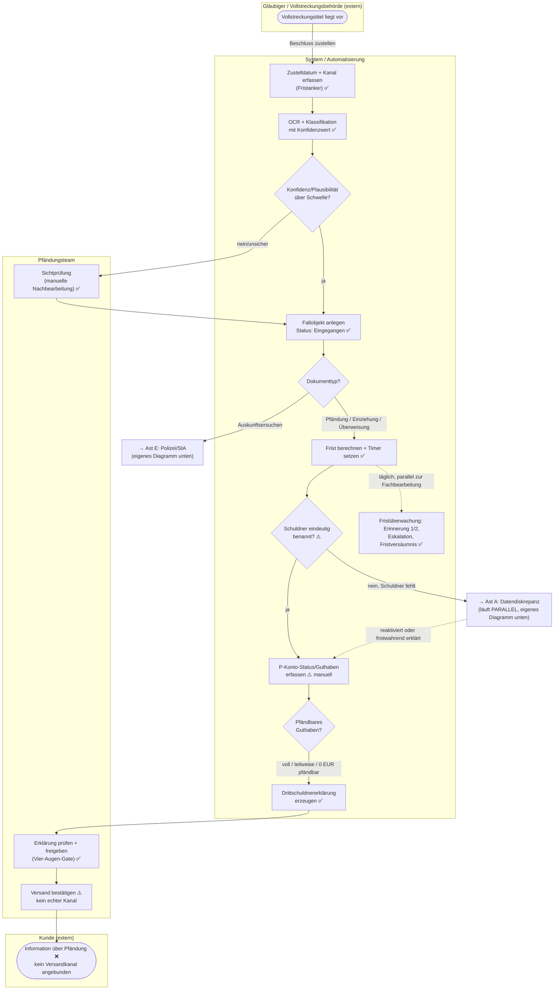
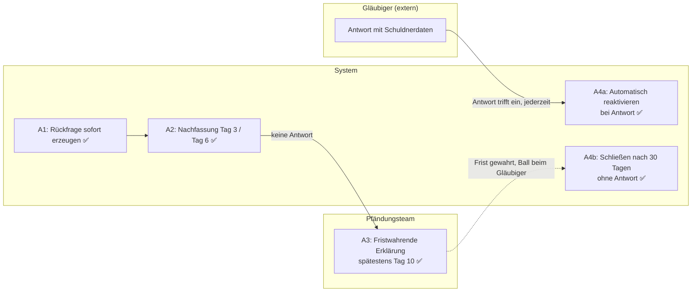

# Soll-Prozess — Pfändung & Auskunftsersuchen

RALPH-PROGRESS.md Backlog #5. Struktur und Fachlogik portiert aus
`Pfaendungsprozess_Analyse_Sollkonzept.html` (Abschnitt 3) und
`Pfaendungsprozess_BPMN_v5_1.html` (vier Diagramme: A Hauptprozess,
B Datendiskrepanz, C Dauerüberwachung, D Auskunftsersuchen) — hier als
Markdown, **jeder Schritt zusätzlich gegen das tatsächlich Gebaute
geprüft und markiert**, nicht nur die Konzeptbeschreibung wiederholt.

**Legende** (gleiche Semantik wie `docs/testmatrix.md`):
- ✅ **Umgesetzt** — läuft im echten Code, live geprüft
- ⚠️ **Näherung/Teilweise** — ein Teil ist gebaut, ein Teil bewusst nicht (meist: keine Kernbank-Anbindung)
- ❌ **Nicht umgesetzt** — bewusste Grenze (README „Bewusste Grenzen") oder noch offene Lücke, keine Behauptung

## Swimlane-Übersicht (Hauptprozess, entspricht BPMN Diagramm A)

Vereinfacht gegenüber der vollen BPMN-Fassung (5716px Originalbreite) auf
die für dieses Repo wesentliche Struktur — die beiden fett hervorgehobenen
Teilprozesse (Ast A, Ast E) sind unten in eigenen Abschnitten im Detail.

## Schritt für Schritt: gemeinsamer Kopf (Sollkonzept 3.0)

| Schritt | Soll-Beschreibung | Status |
|---|---|---|
| 1 — Eingang | Ein Kanal statt zwei, Papier weiter möglich, sofort gescannt | ⚠️ Kein dedizierter eBO-Kanal; Upload-Formular (`Posteingang.jsx`) deckt das Digitalisieren ab, das „ein Kanal statt zwei"-Organisationsziel ist außerhalb des Codes |
| 2 — Erfassung mit Konfidenzschwelle | OCR + Klassifikation, jedes Feld mit Konfidenzwert, unterhalb der Schwelle Sichtprüfung statt Autofall | ✅ `bestimmeRouting()` (`server/mistral.js`), fail-closed: fehlende Konfidenz zählt als „keine Konfidenz" |
| — Sonderfall Erinnerungsschreiben | Kein neuer Fall, Zuordnung über Aktenzeichen, sofortige Eskalation | ✅ `findeFallZuAktenzeichen()`, getestet `docs/testmatrix.md` A6/A7 |
| 3 — Fallanlage | Fall mit ID, Status, Historie; Fristanker = Zustelldatum, nie Scandatum | ✅ Kern-Invariante, siehe `CLAUDE.md`: `zustelldatum`/`eingangsdatum` kommt ausschließlich aus Upload-Metadaten |
| 4 — Fristen setzen | Zwei unabhängige Timer (Erklärungsfrist, § 835 Abs. 3 Wartefrist); Eskalation bei 50 % / 3 Tage / 1 Tag Restlaufzeit | ⚠️ **Siehe Hinweis unten** — die Timer-Logik selbst ist umgesetzt und getestet, aber Erinnerung 1 feuert am Fristbeginn (Tag 0), nicht bei 50 % verbrauchter Frist |
| 5 — Identifikation mit Trefferhierarchie | Automatischer Abgleich gegen Kundenstamm (IBAN eindeutig → Name+Geburtsdatum+Adresse → Name+Geburtsdatum), drei Klassen eindeutig/mehrdeutig/kein Treffer | ❌ Keine Kernbank-/Kundenstamm-API angebunden (bewusste Grenze). Real umgesetzt ist eine einfachere Prüfung: fehlt `pfaendung.schuldner_name` in der Extraktion, wird Ast A ausgelöst — kein echter Abgleich gegen einen Kundenstamm |

**Hinweis zu Schritt 4 (Timing-Diskrepanz zwischen den eigenen Design-Dokumenten):**
Die Sollkonzept-Prosa nennt „50 % verbrauchter Frist" für Erinnerung 1. Die
spätere, detailliertere BPMN-v5-Fassung (Diagramm A: „Timer: Fristbeginn →
Erinnerung 1") und das tatsächlich gebaute n8n-Timing (`erinnerung_1` sofort
bei Fristbeginn, `erinnerung_2` 3 Tage vor Ende, `eskalation` 1 Tag vor Ende
— siehe `server/fristlogik.js`) stimmen exakt überein und weichen beide von
der früheren Prosa ab. Das ist wahrscheinlich eine Design-Verfeinerung
zwischen Sollkonzept und BPMN v5, keine Implementierungslücke — aber die
beiden eigenen Dokumente widersprechen sich an dieser einen Stelle, und das
wurde vor RALPH-PROGRESS.md Iteration 5 nicht bemerkt. In Iteration 3 wurde
dieser Punkt bereits mit dem Nutzer besprochen und die aktuelle Umsetzung
bewusst beibehalten — diese Anmerkung ergänzt nur den vollständigeren Fund
(dass die Abweichung nicht „generisch", sondern zwischen zwei eigenen
Dokumenten besteht) zur Kenntnis, ändert die getroffene Entscheidung nicht.

## Ast A — Datendiskrepanz, parallel zur Frist (Sollkonzept 3.1, BPMN Diagramm B)

Der entscheidende Unterschied zum Ist-Prozess: **dieser Ast blockiert
nichts** — der teuerste Einzelbefund aus `docs/IST-PROZESS.md` Abschnitt 3.

| Schritt | Soll | Status |
|---|---|---|
| A1 — Rückfrage sofort | Strukturierte Rückfrage, unser + sein Aktenzeichen, 3 Werktage Antwortfrist | ✅ `erzeugeRueckfrage()` (`server/datendiskrepanz.js`), ausgelöst in `legePfaendungsfallAn()` |
| A2 — zwei automatische Nachfassungen | Tag 3, Tag 6, ohne menschliches Zutun | ✅ `NACHFASSUNG_1_TAGE_NACH_RUECKFRAGE=3`, `_2_TAGE=6`; jetzt auch protokolliert (RALPH-PROGRESS.md Iteration 1 — vorher stumm) |
| A3 — fristwahrende Erklärung spätestens Tag 10 | Erklärung "keine Geschäftsverbindung feststellbar", Frist gewahrt | ✅ `erzeugeFristwahrendeErklaerung()`, `FRISTWAHREND_SPAETESTENS_TAG=10`, aber **noch als Text-Entwurf** — Freigabe/Versand laufen über denselben menschlichen Zwei-Schritt-Prozess wie eine reguläre Erklärung, siehe `docs/HITL-GRENZEN.md` |
| A4a — automatische Reaktivierung | Antwort trifft später ein → Fall automatisch zugeordnet und reaktiviert | ⚠️ Reaktivierung ist **nicht automatisch** — ein Mensch trägt den Schuldnernamen über `/api/faelle/:id/datendiskrepanz/reaktivieren` nach (bewusste Abweichung: die Antwort selbst kommt oft per Brief/E-Mail außerhalb strukturierter Kanäle, ein automatischer Parser dafür existiert nicht) |
| A4b — Schließung nach 30 Tagen | Kein Rückfrageeingang → Fall geschlossen, Vermerk | ✅ `SCHLIESSEN_NACH_TAGEN_OHNE_ANTWORT=30` |

**Betriebsstatus:** Der Sweep, der A2/A3/A4b auslöst
(`POST /api/sweep/datendiskrepanz`), ist noch nicht in n8n verkabelt (kein
täglicher Trigger) — siehe `CLAUDE.md`. Der Endpunkt selbst funktioniert
und ist getestet, muss aber manuell/extern aufgerufen werden.

## Ast B/C/D — die drei Guthabenfälle (Sollkonzept 3.2–3.4, BPMN Diagramme A + C)

**Wichtigste ehrliche Einordnung dieses gesamten Dokuments:** Das
Sollkonzept beschreibt hier eine vollständige Geldbewegungs-Kette —
Kontostandabfrage über eine Kernbank-API, Sperrbetrag statt Vollsperre,
automatische Überweisung, ereignisgesteuerte Dauerüberwachung künftiger
Zahlungseingänge (BPMN Diagramm C). **Nichts davon existiert im Code**, weil
es eine echte Kernbank-Anbindung voraussetzt, die es in diesem Projekt nie
geben wird (README „Bewusste Grenzen", Annahme A7: Kontostände werden
manuell erfasst). Das ist keine übersehene Lücke, sondern von Anfang an so
angelegt.

Was tatsächlich gebaut ist, deckt einen anderen, kleineren, aber
vollständig funktionierenden Ausschnitt ab: **die korrekte Erstellung und
den kontrollierten Versand der Drittschuldnererklärung selbst**, für alle
drei Guthabenfälle richtig unterschieden.

| Schritt (Sollkonzept) | Status |
|---|---|
| B1/C1/D1 — Kontostandabfrage über Kernbank-API | ❌ Manuell erfasst (`guthaben_eur`, `PfaendungErweiterung.jsx`) |
| B2/C2 — Sperrbetrag statt Vollsperre | ❌ Keine echte Kontosperre, keine Reservierung — nur die *Berechnung* des pfändbaren Betrags ist umgesetzt (`berechnePfaendbarenBetragVorschau()`) |
| B3/C3/D2 — Kundeninformation | ⚠️ Text wird korrekt erzeugt (`pkonto_drittschuldner.js` unterscheidet alle drei Fälle richtig, getestet `docs/testmatrix.md` B1–B3), aber ❌ kein echter Versandkanal — „Versand bestätigen" protokolliert nur eine externe, manuelle Handlung |
| B4/C4 — Wartefrist § 835 Abs. 3 ZPO, dann Überweisung | ❌ Keine automatische Zahlungsauslösung möglich ohne Kernbank |
| C5/D3 — ereignisgesteuerte Dauerüberwachung (BPMN Diagramm C) | ❌ Nicht umgesetzt — es gibt keinen Mechanismus, der auf künftige Zahlungseingänge reagiert. Größte verbleibende konzeptionelle Lücke gegenüber dem vollen Sollkonzept, aber strukturell nicht schließbar ohne Kernbank-Webhook |
| D4 — turnusmäßige Bestandsprüfung (quartalsweise) | ❌ Nicht umgesetzt |
| Drittschuldnererklärung erzeugen/freigeben/versenden | ✅ Vollständig, inkl. Vier-Augen-Gate (`docs/HITL-GRENZEN.md`) und lückenlosem Audit-Trail (RALPH-PROGRESS.md Iteration 1) |

## Ast E — Polizei und Staatsanwaltschaft (Sollkonzept 3.5, BPMN Diagramm D)

Läuft bereits ab der Klassifikation getrennt — eigene Tabelle
(`auskunftsersuchen_faelle`), kein gemeinsamer Postkorb mit Pfändungen.

| Schritt | Soll | Status |
|---|---|---|
| E1 — Vertraulichkeitskennzeichen | Fall mit „vertraulich — keine Kundeninformation" angelegt, sperrt jede automatische Kundenkommunikation | ✅ `vertraulich`-Flag, in der UI als Badge sichtbar (`AE-2026-*` Muster) |
| E2 — Compliance sofort informiert | Bei Fallanlage, nicht erst bei Bearbeitung | ✅ `compliance_informiert`-Ereignis, automatisch bei `legeAuskunftsersuchenFallAn()` |
| E3 — Rechtsgrundlagenprüfung | Mitarbeiter mit Sonderberechtigung prüft, was herausgegeben werden darf | ⚠️ Prüfung ist umgesetzt (`freizugebende_punkte`, `aktualisiereAuskunftsersuchenErweiterung()`) — „Sonderberechtigung" ist nicht technisch durchgesetzt (kein Rollensystem, siehe README „Bewusste Grenzen") |
| E4 — Auskunft erstellen, Compliance-Freigabe, Versand, Protokoll | Vier-Augen | ✅ Vollständig, gleiches Gate-Muster wie Ast B, siehe `docs/HITL-GRENZEN.md` — **das explizit im RALPH-Backlog genannte Beispiel „Datenherausgabe an Polizei/Staatsanwaltschaft muss immer Freigabe erfordern"** |
| E5 — Kontosperre nur bei Rechtsgrundlage | Sperre nur bei Beschlagnahme/Arrest im Schreiben selbst, als Regel hinterlegt | ✅ `entscheideSperre()`, beide Richtungen protokolliert (auch „keine Sperre" als bewusste Entscheidung) — löst keine echte Sperre aus (keine Kernbank), aber genau das ist bei diesem Ast korrekt, siehe Sollkonzept „Offener Punkt für Legal" unten |

**Offener Punkt, den das Sollkonzept selbst als außerhalb dieses Projekts
liegend markiert:** ob die *frühere* Praxis (Konto generell sperren, sobald
ein Behördenschreiben eingeht) rechtlich gedeckt war, ist eine Frage an
Legal, keine Systemfrage — das gebaute System erzwingt bereits die fachlich
korrekte Regel (Sperre nur mit Rechtsgrundlage im Schreiben selbst).

## Zusammenfassung

Von den in diesem Dokument geprüften Schritten sind die **fallführenden,
statusverändernden Schritte** (Fallanlage, Fristüberwachung, Datendiskrepanz,
Drittschuldnererklärung/Antwort-Lebenszyklus, Vier-Augen-Gates,
Audit-Trail) durchgehend ✅ umgesetzt und getestet. Die **Lücken clustern
sich fast vollständig um eine einzige, von Anfang an bewusste Grenze:
keine Kernbank-Anbindung** — daraus folgen direkt alle ❌-Zeilen zu
Kontostandabfrage, Sperrbetrag, echter Überweisung, Dauerüberwachung und
echtem Versandkanal. Das deckt sich mit `docs/IST-PROZESS.md`s Befund:
das strukturelle Kernproblem (kein Fallobjekt) ist gelöst; das verbleibende
Delta zum vollen Sollkonzept ist überwiegend eine externe
Integrationsfrage, keine offene Fachlogik-Lücke.
